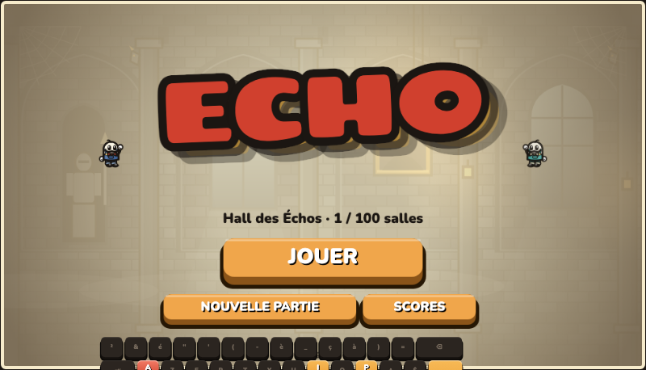

<p align="center">
  
</p>

# Echo

Jeu de plateforme 2D en un seul fichier HTML5 (canvas, sprites inlinés, son synthétisé ; seules les polices viennent de Google Fonts) dans un style dessin animé des années 30. Tu remontes le temps (jauge « Temps »), tu bats 8 boss et tu récupères leurs échos (pouvoirs) pour affronter le Roi des Échos. Jouable au clavier AZERTY et au tactile.

## Jouer

Ouvre `dist/index.html` dans un navigateur, ou héberge le dossier `dist/` sur n'importe quel site statique (Netlify, Cloudflare Pages, un simple serveur web… ; pour GitHub Pages, voir plus bas).

## Développer

Le projet utilise [Vite](https://vite.dev) et des modules ES ; le build produit toujours **un seul fichier** autonome (JS, CSS et sprites inlinés).

```bash
npm install
npm run dev          # serveur de développement avec rechargement à chaud
npm run build        # génère dist/index.html
npm test             # tests de non-régression (Vitest)
npm run lint         # ESLint
npm run typecheck    # TypeScript (tsc --noEmit)
npm run format       # Prettier
```

### Organisation du code

| Dossier | Rôle |
|---|---|
| `src/main.js` | Point d'entrée : charge les modules, lance la boucle, expose `globalThis.__T` en mode test |
| `src/types.ts` | Types du domaine (`GameState`, `Runtime`, `Body`, `Entity`, `Level`…) |
| `src/core/` | Constantes (`config.ts`) et canvas |
| `src/data/` | Données pures : boss, échos et textes, plans des salles dessinées à la main, métriques des sprites |
| `src/state/` | État de la partie (`state.ts`), sauvegarde et scores (`save.js`), variables partagées (`runtime.ts`) |
| `src/world/` | Générateur de salles (`generator.js`), tables du monde (`world.js`), liaisons entre salles (`edges.js`), assemblage des 100 salles (`build.js`), chargement d'une salle (`rooms.js`) |
| `src/game/` | Simulation à 60 Hz : physique, échos, combat (`combat.js`), IA des boss (`boss-ai.js`), Colosse, Reflets, rembobinage, boucle |
| `src/render/` | Dessin : décor, tuiles, personnages, boss (`boss-*.js`, `bosses.js` en est le point d'entrée), scène, sprites |
| `src/ui/` | HUD, écrans (titre, scores, carte, pause) |
| `src/input/` | Clavier, tactile, boutons à l'écran |
| `src/online/` | Classement mondial (Firestore via REST, authentification anonyme, App Check) et mesure d'audience (GA4 avec consentement) |
| `src/config/` | Configuration Firebase |
| `src/audio/` | Musique et effets, entièrement synthétisés (Web Audio) |
| `src/assets/sprites/` | PNG des boss (inlinés au build) |
| `tests/` | Non-régression : monde et physique rejoués de façon déterministe, rendu de toutes les salles |

### Notes d'architecture

- **TypeScript progressif** : le socle (`types.ts`, `core/`, `state/state.ts`, `state/runtime.ts`) est en TypeScript strict ; le reste est en JavaScript (`allowJs`) et migre module par module en renommant le fichier en `.ts`. `npm run typecheck` fait partie de l'intégration continue.

- **Variables partagées** : les variables réassignées depuis plusieurs modules (salle courante, joueur, clone, entités…) vivent dans l'objet `runtime` (`src/state/runtime.ts`), car un `let` exporté ne peut pas être réassigné par l'importeur. L'état persistant de la partie est dans `gameState`.
- **Tests** : `npm test` construit en mode `test`, ce qui active le hook `globalThis.__T` (accès aux internes) ; les tests rejouent des scénarios avec un `Math.random` seedé et comparent des empreintes à la référence produite par le code d'avant le refactor (`tests/golden-scenario.json`).
- **Rendu** : `draw()` est protégé par un `try/catch` dans la boucle pour ne jamais figer le jeu ; le test `render-smoke` l'appelle directement pour que les erreurs de dessin soient visibles.

## Classement mondial (Firebase)

Le jeu enregistre le meilleur score de chaque joueur dans Firestore (offre gratuite Spark), sans SDK : `src/online/leaderboard.js` parle directement à l'API REST.

- **Identité** : authentification anonyme Firebase (aucun compte à créer) ; un document `scores/<uid>` par joueur, mis à jour uniquement si le score s'améliore.
- **Écran** : « SCORES » → onglets *Mes scores* (local) / *Mondial*. Hors ligne ou en cas d'erreur, le classement local reste disponible et la partie n'est jamais bloquée.
- **Sécurité** : les règles [`firestore.rules`](firestore.rules) valident côté serveur le type et les bornes des champs, le nom (1 à 20 caractères), la cohérence de la clé de tri, l'unicité par joueur et l'amélioration obligatoire d'un score existant ; suppression interdite, lecture limitée à 50 lignes. Les règles publiées dans la console Firebase doivent rester identiques à ce fichier.
- **Clé d'API restreinte par référent** : dans Google Cloud Console (Identifiants → « Browser key »), restrictions « Sites Web » : `https://yorcela.github.io/*` et `http://localhost:5173/*`. Un autre site web qui utiliserait la clé est refusé par Google. Si tu héberges le jeu ailleurs, ajoute ton domaine à cette liste.
- **App Check** : chaque requête Firebase porte un jeton `X-Firebase-AppCheck` obtenu via reCAPTCHA Enterprise (clé de site dans `src/config/firebase.js`, domaines `yorcela.github.io` et `localhost`). L'application stricte (« Enforce ») est activée dans la console pour Firestore et Authentication : un script ou un autre site n'obtient pas de jeton valide et est refusé. Le script reCAPTCHA n'est chargé qu'à l'ouverture de l'écran Scores ou à l'envoi d'un score.
- **Plausibilité** : une victoire exige au moins 20 salles explorées et 3 minutes de jeu ; temps minimal de 30 s dans tous les cas.
- **Limite** : le jeu tourne dans le navigateur, un joueur motivé peut donc envoyer un score plausible mais faux (en pilotant le vrai jeu) ; les règles écartent les valeurs impossibles. App Check et le référent empêchent surtout les scripts et les autres sites de parler directement à la base.
- **Configuration** : `src/config/firebase.js` (clés publiques par conception). Vider `apiKey` désactive le mondial.
- **Réutiliser un autre projet Firebase** : créer un projet, activer Firestore (mode production) et l'authentification anonyme, publier `firestore.rules`, puis remplacer la configuration.

## Mesure d'audience (Google Analytics 4)

Le jeu envoie des statistiques anonymes à Google Analytics 4 (propriété liée au projet Firebase, identifiant de mesure dans `src/config/firebase.js`), **uniquement après consentement** :

- **Bandeau** Accepter / Refuser au premier lancement ; le lien « Cookies » en bas à gauche permet de revenir sur le choix. Rien n'est chargé tant que le joueur n'a pas accepté.
- **Pas de publicité** : signaux Google et personnalisation désactivés.
- **Événements** (aucun nom de joueur) : `game_start`, `new_game`, `boss_defeated`, `game_over`, `victory`, `score_submitted`, `scores_opened`, `game_exit` (dernier écran, salle, temps de jeu : permet de voir où les joueurs quittent). Les visites, pays, appareils et durées viennent des rapports GA4 standard.
- **Désactivé en local** (`localhost`, `file:`) pour ne pas fausser les chiffres ; pour tester : `localStorage.setItem('echo-analytics-dev','1')`.
- **Où lire** : [analytics.google.com](https://analytics.google.com) (Temps réel pour vérifier, puis Rapports → Engagement → Événements). Pour utiliser les paramètres personnalisés (`boss`, `rooms`…) dans les rapports, les déclarer dans Admin → Définitions personnalisées.

## Règles de conception

- Boss dans l'ordre : Temps, Jumeaux, L'Envol (double saut), Colosse, Les Reflets (miroir), La Sorcière, La Mémoire (rémanence), L'Éclair.
- Mort : retour à la dernière statue / dernier lit, le chrono continue ; le classement n'enregistre que les parties terminées.
- Les lits ne servent que si on est blessé ou si la jauge de Temps est entamée ; dormir ajoute 20 s au chrono.
- Un coup mortel déclenche un retour arrière automatique de 5 s si la jauge le permet.
- Statues et salles de repos = voyage rapide ; le Hall devient l'arène du roi après 8 pouvoirs.
- Chaque nouvel écho a une durée (10 s par défaut), les clones n'expirent jamais.

## Déploiement GitHub Pages

Le workflow [`.github/workflows/pages.yml`](.github/workflows/pages.yml) lance les tests, construit le jeu et le publie à chaque push sur `main`.

Réglage à faire une seule fois : **Settings → Pages → Build and deployment → Source : « GitHub Actions »**. (Avec « Deploy from a branch », GitHub servirait le `index.html` source du dépôt, qui ne fonctionne pas sans build.)

## Licence

[MIT](LICENSE) : usage, modification et redistribution libres, y compris commerciaux, à condition de conserver la mention de l'auteur (Yorcela) et le texte de la licence.
